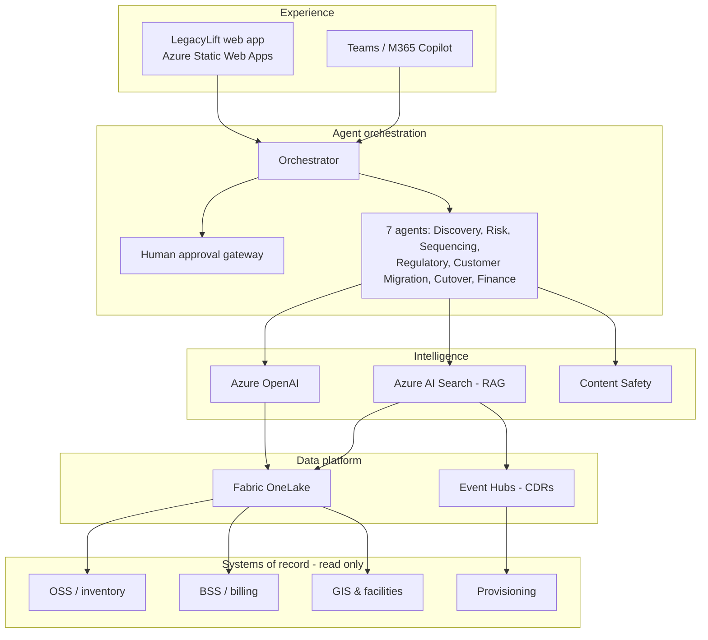

# Architecture

## In this demo

There is no backend. All data is synthetic and generated in `src/data/cos.ts` (seeded RNG). The "AI" is a scripted, streaming mock in `src/services/ai.ts`. The planner (`src/lib/planner.ts`) and finance model (`src/lib/finance.ts`) are real, deterministic code.

## Swapping in Azure OpenAI

Replace the body of `askCopilot` in `src/services/ai.ts` with a call to your own API (for example an Azure Function that proxies Azure OpenAI with On-Your-Data against AI Search) and yield its streamed tokens as `AIChunk`s. Never put keys in the browser.
